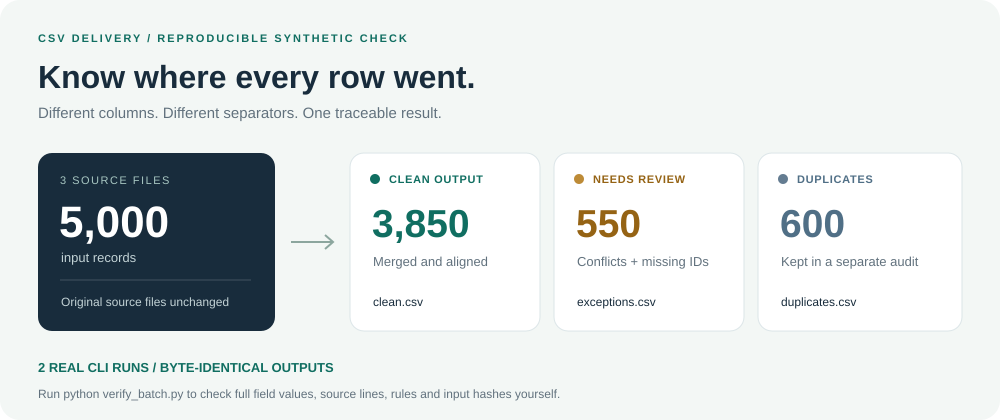

# CSV Delivery

**Several exports. One organised file. Every exception accounted for.**

Bring CSV files with the same columns in a different order, mixed separators, repeated rows or conflicting order IDs. Get a merged file, a separate list of decisions, and the script to run it again.



[Download the example](https://github.com/Yueyue673/csv-delivery-kit/archive/refs/heads/main.zip) · [Inspect the run record](validation/batch-check.json) · [Ask for an adaptation](https://github.com/Yueyue673/csv-delivery-kit/issues/new?template=csv-task.yml)

The diagram summarises an **original synthetic test**, using 3 files and 5,000 records. It is a data-flow diagram; the interactive HTML report is included separately. [Inspect the actual run record](validation/batch-check.json) or reproduce it locally:

```sh
python verify_batch.py
```

This creates the inputs, runs the real CLI twice, compares every output field and audit source line with an independently defined expected result, and checks that the input files stayed unchanged. Both runs produced identical CSV, JSON and HTML files on Windows with Python 3.12.14.

## See what a decision looks like

The smaller [9-row example](demo/inputs) is easy to inspect by eye:

| What came in | What you receive |
| --- | --- |
| Two exports with different column order and separators | One consistent CSV |
| Order `00003` has amounts `8.00` and `9.00` | Both versions in [exceptions.csv](demo/delivery/exceptions.csv), with their original file and line |
| One repeated full row | One output record and a separate [duplicate audit](demo/delivery/duplicates.csv) |
| An ID such as `00001`, an amount such as `19.90` | Text values preserved in [clean.csv](demo/delivery/clean.csv) |

Download the project and open [demo/delivery/preview.html](demo/delivery/preview.html) locally. It includes English/Chinese views, clean/review/duplicate tabs and links to every delivery file. The generated report is self-contained, with no external scripts or fonts.

## Need this adapted to your files?

**Proposed starter: US$25** for up to 3 CSVs, 5,000 records and 20 columns under one agreed rule set. You receive:

- The merged CSV, exception list and duplicate audit.
- A check report plus a script you can run again.
- Short operating notes and one correction against the agreed requirements.

[Describe the result you need](https://github.com/Yueyue673/csv-delivery-kit/issues/new?template=csv-task.yml). One made-up input/output example is enough to begin. We confirm the actual rules, price and delivery date before work starts. This is a public issue: keep client data private.

The tool is free under the MIT licence. Paid work covers adapting the rules, checking the agreed inputs and preparing your handover.

## Run the tool

Python 3.10 or later; standard library only. Keep `preview_template.html` beside `csv_delivery.py`.

```sh
python csv_delivery.py demo/inputs/batch-a.csv demo/inputs/batch-b.csv --output delivery --key order_id --trim --dedupe-exact
```

- Matching column names are aligned even when their order differs.
- Comma, semicolon, tab and pipe separators are detected automatically.
- Whitespace trimming and exact-row removal happen only when selected.
- With `--key`, every conflicting version and every missing-key record goes to the exception file.
- The output directory must be new; inputs and existing output directories are left unchanged.
- `--encoding gb18030` supports GB18030 input. The default row limit is 100,000; `--max-rows` changes it.

If output writing fails, the tool attempts to remove only files it created in that run so the same destination can be retried. It preserves unrelated files and explicitly reports an incomplete cleanup if it cannot remove the directory.

## Verify it

```sh
python -m unittest -v
python verify_batch.py
# Optional: retain the synthetic inputs, both deliveries and result.json in a new directory:
python verify_batch.py --output batch-evidence
```

**17 regression tests** cover parsing, text preservation, duplicate/conflict handling, malformed inputs, output protection and recovery after interrupted writes. The **5,000-row acceptance check** additionally verifies complete field values, audit reasons, physical source line numbers, rules, hashes and byte-identical reruns. It includes Chinese text, leading-zero IDs, different decimal string lengths, quoted commas, quotes and embedded newlines. [Validation notes](VALIDATION.txt).

To rebuild the small demo from scratch, run `python build_demo.py` in a fresh copy without an existing `demo` directory. The builder deliberately refuses to overwrite its earlier result.

## Import and processing notes

CSV files do not carry column types. In Excel, use **Data → From Text/CSV** and import identifier columns as **Text** to retain leading zeroes. Import untrusted fields as text as well; the tool does not evaluate spreadsheet formulas.

The tool applies the selected rules. It does not choose the correct business value from conflicting records. Different column sets require an agreed mapping first. The included examples use synthetic data; actual customer files and target applications need their own acceptance checks. No XLSX, OCR or third-party integration is included in this example.

MIT licensed. [中文说明](README.txt).
