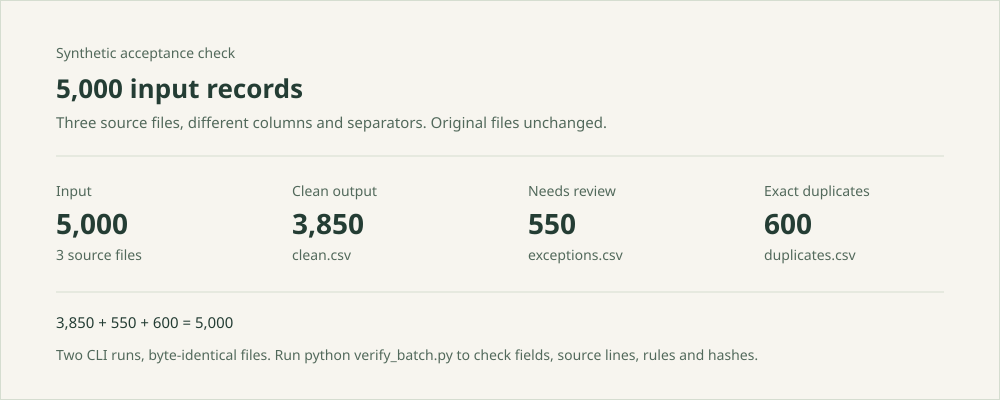

# CSV 整理交付

把几份列名相同、但列顺序或分隔符可能不同的 CSV 合成一份表。完全重复的行可以单独列出，内容冲突或缺编号的记录也会单独列出，并标上来源文件和行号。同时留下以后还能再跑的脚本。



[下载示例](https://github.com/Yueyue673/csv-delivery-kit/archive/refs/heads/main.zip) · [查看运行记录](validation/batch-check.json) · [说明你需要怎样改](https://github.com/Yueyue673/csv-delivery-kit/issues/new?template=csv-task.yml)

图里是一次合成数据验收，用了 3 个文件、共 5,000 条记录。交互式 HTML 报告在交付结果里，另外打开。也可以在本地复现：

```sh
python verify_batch.py
```

它会生成输入，把真正的命令行程序跑两遍，把每项输出字段和审核来源行与事先写好的预期结果比对，并确认输入文件没有被改动。两次运行得到的 CSV、JSON 和 HTML 在 Windows、Python 3.12.14 上逐字节相同。

## 先看一个小例子

[9 行示例](demo/inputs) 可以直接对着看：

| 送进去的 | 你会拿到的 |
| --- | --- |
| 两份列顺序和分隔符不同的导出 | 一份格式一致的 CSV |
| 编号 `00003` 分别是金额 `8.00` 和 `9.00` | 两个版本都在 [exceptions.csv](demo/delivery/exceptions.csv)，带原文件和行号 |
| 有一行完全重复 | 主表留一条，另有 [重复清单](demo/delivery/duplicates.csv) |
| 像 `00001` 这样的编号、像 `19.90` 这样的金额 | 在 [clean.csv](demo/delivery/clean.csv) 里按文本原样保留 |

两份文件、9 条输入，得到 5 条整理结果、3 条待确认、1 条完全重复。

下载项目后，在本地打开 [demo/delivery/preview.html](demo/delivery/preview.html)。可以切换中英文，切换整理结果 / 待确认 / 重复，并下载全部结果文件。这份报告是自包含的，不加载外部脚本或字体。

## 如果要按你的文件改一版

起步价是 **25 美元**，范围是最多 3 份 CSV、共 5,000 条记录、20 列，规则先约定好。你会拿到：

- 合并后的 CSV、待确认清单和重复清单
- 一份检查报告，以及可以再跑一次的脚本
- 简短使用说明，并在约定范围内改一次

[先说明你要的结果](https://github.com/Yueyue673/csv-delivery-kit/issues/new?template=csv-task.yml)。用一份编造或脱敏的输入输出例子就可以开始谈。真正的规则、价格和交付日期会在开工前确认。Issue 是公开的，不要放真实客户数据。

工具本身按 MIT 许可免费使用。付费部分是按约定规则改适、核对这些输入，并整理交付。程序本身没有收款功能。交付完成不等于成交或到账。

## 自己运行

需要 Python 3.10 或更新版本，只用标准库。请把 `preview_template.html` 和 `csv_delivery.py` 放在同一文件夹。运行时在本机处理，不联网，不调用 AI。

```sh
python csv_delivery.py demo/inputs/batch-a.csv demo/inputs/batch-b.csv --output delivery --key order_id --trim --dedupe-exact
```

- 列名相同但顺序不同时，会按列名对齐
- 逗号、分号、制表符和竖线分隔符会自动识别
- 去掉首尾空格、删除完全重复行，只有你选了对应选项才会做
- 指定了 `--key` 后，内容冲突和缺编号的记录都会进待确认文件
- 输出目录必须是新的；输入和已有输出目录不会被改写
- `--encoding gb18030` 用于 GB18030 输入。默认最多 100,000 行，可用 `--max-rows` 改

如果写出失败，程序会尽量只删掉这次创建的文件，方便用同一个目标目录重试。别人的文件会留下。如果目录没能清理干净，会明确提示。

## 验收

```sh
python -m unittest -v
python verify_batch.py
# 如果想留下合成输入、两次交付结果和 result.json，换一个新目录：
python verify_batch.py --output batch-evidence
```

**17 项回归测试**覆盖解析、文本原样保留、重复和冲突处理、格式不对的输入、输出保护，以及写入中断后的清理。**5,000 行验收**还会核对完整字段值、审核原因、原文件物理行号、规则、哈希，以及两次运行的文件是否逐字节相同。这次实际结果是 3850 条整理结果、600 条重复、550 条待确认（150 个冲突编号、250 行缺编号）。里面有中文、前导零编号、不同长度的小数字符串、带引号的逗号、引号和换行。[验收说明](VALIDATION.txt)。

若要从头生成小演示，在一份还没有 `demo` 目录的拷贝里运行 `python build_demo.py`。已有结果时，生成脚本会拒绝覆盖。

## 用 Excel 打开时

CSV 本身没有列类型。请用 **数据 → 从文本/CSV** 导入，并把编号列设为 **文本**，否则前导零可能被改成数字。不信任的字段也建议按文本导入。这个工具不会去执行表格公式。

它只执行你选的规则，不会在冲突记录里替你选哪一条是对的。列名不一致时，要先约定对应关系。当前只处理 CSV，不含 XLSX、OCR 或和其他软件的对接。

MIT 许可。纯文本说明见 [README.txt](README.txt)。

<details>
<summary>English</summary>

This tool merges CSV files that share the same column names, even when the column order or separators differ. Exact duplicate rows can be listed separately. Conflicting records or missing IDs go to an exception file, with the original file and line number. You also get a script you can run again.

The diagram is from a synthetic check with 3 files and 5,000 records: 3,850 clean, 550 for review, 600 exact duplicates. Reproduce it with `python verify_batch.py`. Both runs produced identical CSV, JSON and HTML files on Windows with Python 3.12.14.

A paid adaptation starts at US$25 for up to 3 CSVs, 5,000 records and 20 columns under one agreed rule set. The tool itself stays free under MIT. Open an issue with a made-up or redacted example; confirm the rules, price and date before work starts. Do not post real client data in the public issue.

Requires Python 3.10+ and the standard library. Keep `preview_template.html` beside `csv_delivery.py`. See the Chinese text for the full command, flags and Excel import notes.

</details>
